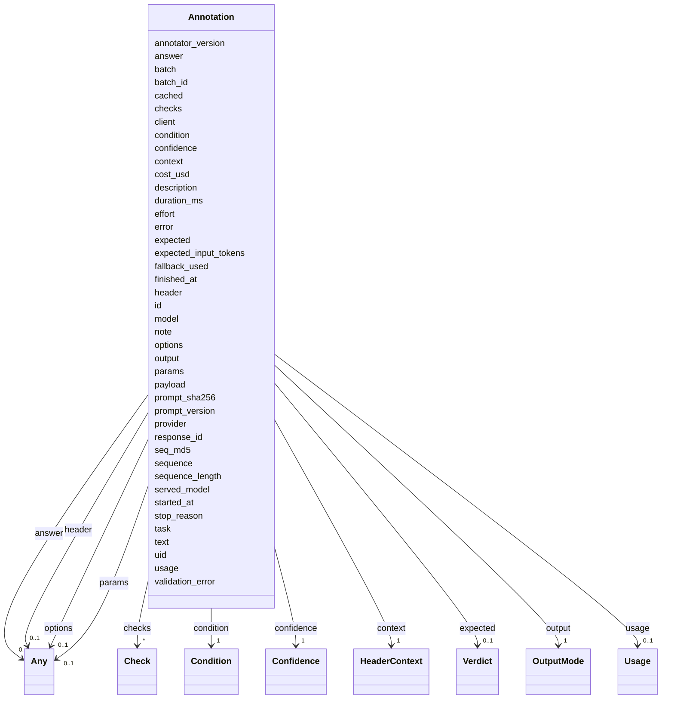

---
search:
  boost: 10.0
---

# Class: Annotation 


_One answer to one task for one sequence, with provenance, checks and cost. A reused (cached) answer keeps the uid of the call that produced it, so merged exports deduplicate on uid._


<div data-search-exclude markdown="1">


URI: [peptalk:Annotation](https://w3id.org/ai4curation/peptalk/Annotation)





<!-- no inheritance hierarchy -->

## Slots

| Name | Cardinality and Range | Description | Inheritance |
| ---  | --- | --- | --- |
| [uid](uid.md) | 1 <br/> [String](String.md) | The call that produced the answer | direct |
| [id](id.md) | 1 <br/> [String](String.md) | The first word of the sequence's FASTA header, as given | direct |
| [description](description.md) | 0..1 <br/> [String](String.md) | The rest of the FASTA header line | direct |
| [task](task.md) | 1 <br/> [String](String.md) | The template asked | direct |
| [condition](condition.md) | 1 <br/> [Condition](Condition.md) | The real sequence, or its shuffled copy (the control) | direct |
| [sequence](sequence.md) | 1 <br/> [String](String.md) | The residues asked (for a shuffled control, the shuffled residues) | direct |
| [seq_md5](seq_md5.md) | 1 <br/> [String](String.md) | MD5 of the upper-case residues asked, the checksum UniParc uses | direct |
| [sequence_length](sequence_length.md) | 1 <br/> [Integer](Integer.md) |  | direct |
| [provider](provider.md) | 1 <br/> [String](String.md) | anthropic, gemini, openai, or stub | direct |
| [model](model.md) | 1 <br/> [String](String.md) | The model requested | direct |
| [effort](effort.md) | 1 <br/> [String](String.md) | The effort or thinking level, in the provider's own labels | direct |
| [options](options.md) | 0..1 <br/> [Any](Any.md) | Every request field besides the prompt, as sent | direct |
| [client](client.md) | 0..1 <br/> [String](String.md) | The client library and its version | direct |
| [annotator_version](annotator_version.md) | 0..1 <br/> [String](String.md) | The peptalk version that made the call | direct |
| [served_model](served_model.md) | 0..1 <br/> [String](String.md) | The model that answered, as the provider reports it | direct |
| [fallback_used](fallback_used.md) | 1 <br/> [Boolean](Boolean.md) | True if a server-side fallback model answered instead of the one requested | direct |
| [response_id](response_id.md) | 0..1 <br/> [String](String.md) | The provider's id for the response | direct |
| [prompt_version](prompt_version.md) | 1 <br/> [String](String.md) | First 12 hex digits of the SHA-256 of the template's prompt file | direct |
| [prompt_sha256](prompt_sha256.md) | 1 <br/> [String](String.md) | SHA-256 of the full prompt sent | direct |
| [context](context.md) | 1 <br/> [HeaderContext](HeaderContext.md) | How much of the FASTA header the model saw | direct |
| [output](output.md) | 1 <br/> [OutputMode](OutputMode.md) | Free text parsed for JSON (the default), or provider structured output | direct |
| [params](params.md) | 0..1 <br/> [Any](Any.md) | The template's parameters (ask templates) | direct |
| [payload](payload.md) | * <br/> [String](String.md) | Optional answer keys asked for (confidence, rationale, evidence, alternatives... | direct |
| [expected](expected.md) | 0..1 <br/> [Verdict](Verdict.md) | The verdict a claim expected | direct |
| [note](note.md) | 0..1 <br/> [String](String.md) | The claim's note | direct |
| [header](header.md) | 0..1 <br/> [Any](Any.md) | Every field parsed from the FASTA header (accession, organism, taxon id,  | direct |
| [text](text.md) | 0..1 <br/> [String](String.md) | The model's reply, verbatim | direct |
| [answer](answer.md) | 0..1 <br/> [Any](Any.md) | The answer object parsed from the reply: open-ended, shaped by the template (... | direct |
| [validation_error](validation_error.md) | 0..1 <br/> [String](String.md) | Why the answer object failed the template's answer model, if it did | direct |
| [stop_reason](stop_reason.md) | 0..1 <br/> [String](String.md) | Why the model stopped, as the provider reports it; `refusal:<category>` for a... | direct |
| [error](error.md) | 0..1 <br/> [String](String.md) | Why the call failed, if it did | direct |
| [usage](usage.md) | 0..1 <br/> [Usage](Usage.md) | Token counts | direct |
| [expected_input_tokens](expected_input_tokens.md) | 0..1 <br/> [Integer](Integer.md) | The provider's count of the request alone; checked against the reported input | direct |
| [cost_usd](cost_usd.md) | 0..1 <br/> [Float](Float.md) | Cost in US dollars at list price, if the model has a price | direct |
| [batch](batch.md) | 1 <br/> [Boolean](Boolean.md) | True if asked through a provider batch API | direct |
| [batch_id](batch_id.md) | 0..1 <br/> [String](String.md) | The provider's batch id | direct |
| [cached](cached.md) | 1 <br/> [Boolean](Boolean.md) | True if this answer was reused from the store instead of asked again | direct |
| [checks](checks.md) | * <br/> [Check](Check.md) | The automatic checks of the answer | direct |
| [confidence](confidence.md) | 1 <br/> [Confidence](Confidence.md) | peptalk's own result from its checks (not the model's stated confidence, whic... | direct |
| [started_at](started_at.md) | 1 <br/> [String](String.md) | When the call started (ISO 8601, UTC) | direct |
| [finished_at](finished_at.md) | 0..1 <br/> [String](String.md) | When the call finished (ISO 8601, UTC) | direct |
| [duration_ms](duration_ms.md) | 0..1 <br/> [Integer](Integer.md) |  | direct |


## Identifier and Mapping Information


### Schema Source


* from schema: https://w3id.org/ai4curation/peptalk


## Mappings

| Mapping Type | Mapped Value |
| ---  | ---  |
| self | peptalk:Annotation |
| native | peptalk:Annotation |


## LinkML Source

<!-- TODO: investigate https://stackoverflow.com/questions/37606292/how-to-create-tabbed-code-blocks-in-mkdocs-or-sphinx -->

### Direct

<details>
```yaml
name: Annotation
description: One answer to one task for one sequence, with provenance, checks and
  cost. A reused (cached) answer keeps the uid of the call that produced it, so merged
  exports deduplicate on uid.
from_schema: https://w3id.org/ai4curation/peptalk
attributes:
  uid:
    name: uid
    description: The call that produced the answer.
    from_schema: https://w3id.org/ai4curation/peptalk
    rank: 1000
    identifier: true
    domain_of:
    - Annotation
  id:
    name: id
    description: The first word of the sequence's FASTA header, as given.
    from_schema: https://w3id.org/ai4curation/peptalk
    domain_of:
    - ProteinClaims
    - Claim
    - Annotation
    required: true
  description:
    name: description
    description: The rest of the FASTA header line.
    from_schema: https://w3id.org/ai4curation/peptalk
    rank: 1000
    domain_of:
    - Annotation
  task:
    name: task
    description: The template asked.
    from_schema: https://w3id.org/ai4curation/peptalk
    domain_of:
    - ClaimBody
    - Annotation
    required: true
  condition:
    name: condition
    description: The real sequence, or its shuffled copy (the control).
    from_schema: https://w3id.org/ai4curation/peptalk
    rank: 1000
    ifabsent: string(real)
    domain_of:
    - Annotation
    range: Condition
    required: true
  sequence:
    name: sequence
    description: The residues asked (for a shuffled control, the shuffled residues).
    from_schema: https://w3id.org/ai4curation/peptalk
    rank: 1000
    domain_of:
    - Annotation
    required: true
  seq_md5:
    name: seq_md5
    description: MD5 of the upper-case residues asked, the checksum UniParc uses.
      The key to the sequence.
    from_schema: https://w3id.org/ai4curation/peptalk
    rank: 1000
    domain_of:
    - Annotation
    required: true
  sequence_length:
    name: sequence_length
    from_schema: https://w3id.org/ai4curation/peptalk
    rank: 1000
    domain_of:
    - Annotation
    range: integer
    required: true
  provider:
    name: provider
    description: anthropic, gemini, openai, or stub.
    from_schema: https://w3id.org/ai4curation/peptalk
    rank: 1000
    domain_of:
    - Annotation
    required: true
  model:
    name: model
    description: The model requested.
    from_schema: https://w3id.org/ai4curation/peptalk
    rank: 1000
    domain_of:
    - Annotation
    required: true
  effort:
    name: effort
    description: The effort or thinking level, in the provider's own labels.
    from_schema: https://w3id.org/ai4curation/peptalk
    rank: 1000
    domain_of:
    - Annotation
    required: true
  options:
    name: options
    description: Every request field besides the prompt, as sent.
    from_schema: https://w3id.org/ai4curation/peptalk
    rank: 1000
    domain_of:
    - Annotation
    range: Any
  client:
    name: client
    description: The client library and its version.
    from_schema: https://w3id.org/ai4curation/peptalk
    rank: 1000
    domain_of:
    - Annotation
  annotator_version:
    name: annotator_version
    description: The peptalk version that made the call.
    from_schema: https://w3id.org/ai4curation/peptalk
    rank: 1000
    domain_of:
    - Annotation
  served_model:
    name: served_model
    description: The model that answered, as the provider reports it.
    from_schema: https://w3id.org/ai4curation/peptalk
    rank: 1000
    domain_of:
    - Annotation
  fallback_used:
    name: fallback_used
    description: True if a server-side fallback model answered instead of the one
      requested.
    from_schema: https://w3id.org/ai4curation/peptalk
    rank: 1000
    ifabsent: 'False'
    domain_of:
    - Annotation
    range: boolean
    required: true
  response_id:
    name: response_id
    description: The provider's id for the response.
    from_schema: https://w3id.org/ai4curation/peptalk
    rank: 1000
    domain_of:
    - Annotation
  prompt_version:
    name: prompt_version
    description: First 12 hex digits of the SHA-256 of the template's prompt file.
    from_schema: https://w3id.org/ai4curation/peptalk
    rank: 1000
    domain_of:
    - Annotation
    required: true
  prompt_sha256:
    name: prompt_sha256
    description: SHA-256 of the full prompt sent.
    from_schema: https://w3id.org/ai4curation/peptalk
    rank: 1000
    domain_of:
    - Annotation
    required: true
  context:
    name: context
    description: How much of the FASTA header the model saw.
    from_schema: https://w3id.org/ai4curation/peptalk
    rank: 1000
    ifabsent: string(blind)
    domain_of:
    - Annotation
    range: HeaderContext
    required: true
  output:
    name: output
    description: Free text parsed for JSON (the default), or provider structured output.
    from_schema: https://w3id.org/ai4curation/peptalk
    rank: 1000
    ifabsent: string(text)
    domain_of:
    - Annotation
    range: OutputMode
    required: true
  params:
    name: params
    description: The template's parameters (ask templates).
    from_schema: https://w3id.org/ai4curation/peptalk
    domain_of:
    - ClaimBody
    - Annotation
    range: Any
  payload:
    name: payload
    description: Optional answer keys asked for (confidence, rationale, evidence,
      alternatives).
    from_schema: https://w3id.org/ai4curation/peptalk
    rank: 1000
    domain_of:
    - Annotation
    multivalued: true
  expected:
    name: expected
    description: The verdict a claim expected. Never sent to the model.
    from_schema: https://w3id.org/ai4curation/peptalk
    domain_of:
    - ClaimBody
    - Annotation
    range: Verdict
  note:
    name: note
    description: The claim's note. Never sent to the model.
    from_schema: https://w3id.org/ai4curation/peptalk
    domain_of:
    - ClaimBody
    - Annotation
  header:
    name: header
    description: Every field parsed from the FASTA header (accession, organism, taxon
      id, ...).
    from_schema: https://w3id.org/ai4curation/peptalk
    rank: 1000
    domain_of:
    - Annotation
    range: Any
  text:
    name: text
    description: The model's reply, verbatim.
    from_schema: https://w3id.org/ai4curation/peptalk
    rank: 1000
    domain_of:
    - Annotation
  answer:
    name: answer
    description: 'The answer object parsed from the reply: open-ended, shaped by the
      template (its JSON Schema is `peptalk tasks --schema TASK`).'
    from_schema: https://w3id.org/ai4curation/peptalk
    rank: 1000
    domain_of:
    - Annotation
    range: Any
  validation_error:
    name: validation_error
    description: Why the answer object failed the template's answer model, if it did.
    from_schema: https://w3id.org/ai4curation/peptalk
    rank: 1000
    domain_of:
    - Annotation
  stop_reason:
    name: stop_reason
    description: Why the model stopped, as the provider reports it; `refusal:<category>`
      for a refusal.
    from_schema: https://w3id.org/ai4curation/peptalk
    rank: 1000
    domain_of:
    - Annotation
  error:
    name: error
    description: Why the call failed, if it did.
    from_schema: https://w3id.org/ai4curation/peptalk
    rank: 1000
    domain_of:
    - Annotation
  usage:
    name: usage
    description: Token counts.
    from_schema: https://w3id.org/ai4curation/peptalk
    rank: 1000
    domain_of:
    - Annotation
    range: Usage
    inlined: true
  expected_input_tokens:
    name: expected_input_tokens
    description: The provider's count of the request alone; checked against the reported
      input.
    from_schema: https://w3id.org/ai4curation/peptalk
    rank: 1000
    domain_of:
    - Annotation
    range: integer
  cost_usd:
    name: cost_usd
    description: Cost in US dollars at list price, if the model has a price.
    from_schema: https://w3id.org/ai4curation/peptalk
    rank: 1000
    domain_of:
    - Annotation
    range: float
  batch:
    name: batch
    description: True if asked through a provider batch API.
    from_schema: https://w3id.org/ai4curation/peptalk
    rank: 1000
    ifabsent: 'False'
    domain_of:
    - Annotation
    range: boolean
    required: true
  batch_id:
    name: batch_id
    description: The provider's batch id.
    from_schema: https://w3id.org/ai4curation/peptalk
    rank: 1000
    domain_of:
    - Annotation
  cached:
    name: cached
    description: True if this answer was reused from the store instead of asked again.
    from_schema: https://w3id.org/ai4curation/peptalk
    rank: 1000
    ifabsent: 'False'
    domain_of:
    - Annotation
    range: boolean
    required: true
  checks:
    name: checks
    description: The automatic checks of the answer.
    from_schema: https://w3id.org/ai4curation/peptalk
    rank: 1000
    domain_of:
    - Annotation
    range: Check
    multivalued: true
    inlined_as_list: true
  confidence:
    name: confidence
    description: peptalk's own result from its checks (not the model's stated confidence,
      which is in the answer).
    from_schema: https://w3id.org/ai4curation/peptalk
    rank: 1000
    ifabsent: string(no_answer)
    domain_of:
    - Annotation
    range: Confidence
    required: true
  started_at:
    name: started_at
    description: When the call started (ISO 8601, UTC).
    from_schema: https://w3id.org/ai4curation/peptalk
    rank: 1000
    domain_of:
    - Annotation
    required: true
  finished_at:
    name: finished_at
    description: When the call finished (ISO 8601, UTC).
    from_schema: https://w3id.org/ai4curation/peptalk
    rank: 1000
    domain_of:
    - Annotation
  duration_ms:
    name: duration_ms
    from_schema: https://w3id.org/ai4curation/peptalk
    rank: 1000
    domain_of:
    - Annotation
    range: integer

```
</details>

### Induced

<details>
```yaml
name: Annotation
description: One answer to one task for one sequence, with provenance, checks and
  cost. A reused (cached) answer keeps the uid of the call that produced it, so merged
  exports deduplicate on uid.
from_schema: https://w3id.org/ai4curation/peptalk
attributes:
  uid:
    name: uid
    description: The call that produced the answer.
    from_schema: https://w3id.org/ai4curation/peptalk
    rank: 1000
    identifier: true
    owner: Annotation
    domain_of:
    - Annotation
    range: string
    required: true
  id:
    name: id
    description: The first word of the sequence's FASTA header, as given.
    from_schema: https://w3id.org/ai4curation/peptalk
    owner: Annotation
    domain_of:
    - ProteinClaims
    - Claim
    - Annotation
    range: string
    required: true
  description:
    name: description
    description: The rest of the FASTA header line.
    from_schema: https://w3id.org/ai4curation/peptalk
    rank: 1000
    owner: Annotation
    domain_of:
    - Annotation
    range: string
  task:
    name: task
    description: The template asked.
    from_schema: https://w3id.org/ai4curation/peptalk
    owner: Annotation
    domain_of:
    - ClaimBody
    - Annotation
    range: string
    required: true
  condition:
    name: condition
    description: The real sequence, or its shuffled copy (the control).
    from_schema: https://w3id.org/ai4curation/peptalk
    rank: 1000
    ifabsent: string(real)
    owner: Annotation
    domain_of:
    - Annotation
    range: Condition
    required: true
  sequence:
    name: sequence
    description: The residues asked (for a shuffled control, the shuffled residues).
    from_schema: https://w3id.org/ai4curation/peptalk
    rank: 1000
    owner: Annotation
    domain_of:
    - Annotation
    range: string
    required: true
  seq_md5:
    name: seq_md5
    description: MD5 of the upper-case residues asked, the checksum UniParc uses.
      The key to the sequence.
    from_schema: https://w3id.org/ai4curation/peptalk
    rank: 1000
    owner: Annotation
    domain_of:
    - Annotation
    range: string
    required: true
  sequence_length:
    name: sequence_length
    from_schema: https://w3id.org/ai4curation/peptalk
    rank: 1000
    owner: Annotation
    domain_of:
    - Annotation
    range: integer
    required: true
  provider:
    name: provider
    description: anthropic, gemini, openai, or stub.
    from_schema: https://w3id.org/ai4curation/peptalk
    rank: 1000
    owner: Annotation
    domain_of:
    - Annotation
    range: string
    required: true
  model:
    name: model
    description: The model requested.
    from_schema: https://w3id.org/ai4curation/peptalk
    rank: 1000
    owner: Annotation
    domain_of:
    - Annotation
    range: string
    required: true
  effort:
    name: effort
    description: The effort or thinking level, in the provider's own labels.
    from_schema: https://w3id.org/ai4curation/peptalk
    rank: 1000
    owner: Annotation
    domain_of:
    - Annotation
    range: string
    required: true
  options:
    name: options
    description: Every request field besides the prompt, as sent.
    from_schema: https://w3id.org/ai4curation/peptalk
    rank: 1000
    owner: Annotation
    domain_of:
    - Annotation
    range: Any
  client:
    name: client
    description: The client library and its version.
    from_schema: https://w3id.org/ai4curation/peptalk
    rank: 1000
    owner: Annotation
    domain_of:
    - Annotation
    range: string
  annotator_version:
    name: annotator_version
    description: The peptalk version that made the call.
    from_schema: https://w3id.org/ai4curation/peptalk
    rank: 1000
    owner: Annotation
    domain_of:
    - Annotation
    range: string
  served_model:
    name: served_model
    description: The model that answered, as the provider reports it.
    from_schema: https://w3id.org/ai4curation/peptalk
    rank: 1000
    owner: Annotation
    domain_of:
    - Annotation
    range: string
  fallback_used:
    name: fallback_used
    description: True if a server-side fallback model answered instead of the one
      requested.
    from_schema: https://w3id.org/ai4curation/peptalk
    rank: 1000
    ifabsent: 'False'
    owner: Annotation
    domain_of:
    - Annotation
    range: boolean
    required: true
  response_id:
    name: response_id
    description: The provider's id for the response.
    from_schema: https://w3id.org/ai4curation/peptalk
    rank: 1000
    owner: Annotation
    domain_of:
    - Annotation
    range: string
  prompt_version:
    name: prompt_version
    description: First 12 hex digits of the SHA-256 of the template's prompt file.
    from_schema: https://w3id.org/ai4curation/peptalk
    rank: 1000
    owner: Annotation
    domain_of:
    - Annotation
    range: string
    required: true
  prompt_sha256:
    name: prompt_sha256
    description: SHA-256 of the full prompt sent.
    from_schema: https://w3id.org/ai4curation/peptalk
    rank: 1000
    owner: Annotation
    domain_of:
    - Annotation
    range: string
    required: true
  context:
    name: context
    description: How much of the FASTA header the model saw.
    from_schema: https://w3id.org/ai4curation/peptalk
    rank: 1000
    ifabsent: string(blind)
    owner: Annotation
    domain_of:
    - Annotation
    range: HeaderContext
    required: true
  output:
    name: output
    description: Free text parsed for JSON (the default), or provider structured output.
    from_schema: https://w3id.org/ai4curation/peptalk
    rank: 1000
    ifabsent: string(text)
    owner: Annotation
    domain_of:
    - Annotation
    range: OutputMode
    required: true
  params:
    name: params
    description: The template's parameters (ask templates).
    from_schema: https://w3id.org/ai4curation/peptalk
    owner: Annotation
    domain_of:
    - ClaimBody
    - Annotation
    range: Any
  payload:
    name: payload
    description: Optional answer keys asked for (confidence, rationale, evidence,
      alternatives).
    from_schema: https://w3id.org/ai4curation/peptalk
    rank: 1000
    owner: Annotation
    domain_of:
    - Annotation
    range: string
    multivalued: true
  expected:
    name: expected
    description: The verdict a claim expected. Never sent to the model.
    from_schema: https://w3id.org/ai4curation/peptalk
    owner: Annotation
    domain_of:
    - ClaimBody
    - Annotation
    range: Verdict
  note:
    name: note
    description: The claim's note. Never sent to the model.
    from_schema: https://w3id.org/ai4curation/peptalk
    owner: Annotation
    domain_of:
    - ClaimBody
    - Annotation
    range: string
  header:
    name: header
    description: Every field parsed from the FASTA header (accession, organism, taxon
      id, ...).
    from_schema: https://w3id.org/ai4curation/peptalk
    rank: 1000
    owner: Annotation
    domain_of:
    - Annotation
    range: Any
  text:
    name: text
    description: The model's reply, verbatim.
    from_schema: https://w3id.org/ai4curation/peptalk
    rank: 1000
    owner: Annotation
    domain_of:
    - Annotation
    range: string
  answer:
    name: answer
    description: 'The answer object parsed from the reply: open-ended, shaped by the
      template (its JSON Schema is `peptalk tasks --schema TASK`).'
    from_schema: https://w3id.org/ai4curation/peptalk
    rank: 1000
    owner: Annotation
    domain_of:
    - Annotation
    range: Any
  validation_error:
    name: validation_error
    description: Why the answer object failed the template's answer model, if it did.
    from_schema: https://w3id.org/ai4curation/peptalk
    rank: 1000
    owner: Annotation
    domain_of:
    - Annotation
    range: string
  stop_reason:
    name: stop_reason
    description: Why the model stopped, as the provider reports it; `refusal:<category>`
      for a refusal.
    from_schema: https://w3id.org/ai4curation/peptalk
    rank: 1000
    owner: Annotation
    domain_of:
    - Annotation
    range: string
  error:
    name: error
    description: Why the call failed, if it did.
    from_schema: https://w3id.org/ai4curation/peptalk
    rank: 1000
    owner: Annotation
    domain_of:
    - Annotation
    range: string
  usage:
    name: usage
    description: Token counts.
    from_schema: https://w3id.org/ai4curation/peptalk
    rank: 1000
    owner: Annotation
    domain_of:
    - Annotation
    range: Usage
    inlined: true
  expected_input_tokens:
    name: expected_input_tokens
    description: The provider's count of the request alone; checked against the reported
      input.
    from_schema: https://w3id.org/ai4curation/peptalk
    rank: 1000
    owner: Annotation
    domain_of:
    - Annotation
    range: integer
  cost_usd:
    name: cost_usd
    description: Cost in US dollars at list price, if the model has a price.
    from_schema: https://w3id.org/ai4curation/peptalk
    rank: 1000
    owner: Annotation
    domain_of:
    - Annotation
    range: float
  batch:
    name: batch
    description: True if asked through a provider batch API.
    from_schema: https://w3id.org/ai4curation/peptalk
    rank: 1000
    ifabsent: 'False'
    owner: Annotation
    domain_of:
    - Annotation
    range: boolean
    required: true
  batch_id:
    name: batch_id
    description: The provider's batch id.
    from_schema: https://w3id.org/ai4curation/peptalk
    rank: 1000
    owner: Annotation
    domain_of:
    - Annotation
    range: string
  cached:
    name: cached
    description: True if this answer was reused from the store instead of asked again.
    from_schema: https://w3id.org/ai4curation/peptalk
    rank: 1000
    ifabsent: 'False'
    owner: Annotation
    domain_of:
    - Annotation
    range: boolean
    required: true
  checks:
    name: checks
    description: The automatic checks of the answer.
    from_schema: https://w3id.org/ai4curation/peptalk
    rank: 1000
    owner: Annotation
    domain_of:
    - Annotation
    range: Check
    multivalued: true
    inlined: true
    inlined_as_list: true
  confidence:
    name: confidence
    description: peptalk's own result from its checks (not the model's stated confidence,
      which is in the answer).
    from_schema: https://w3id.org/ai4curation/peptalk
    rank: 1000
    ifabsent: string(no_answer)
    owner: Annotation
    domain_of:
    - Annotation
    range: Confidence
    required: true
  started_at:
    name: started_at
    description: When the call started (ISO 8601, UTC).
    from_schema: https://w3id.org/ai4curation/peptalk
    rank: 1000
    owner: Annotation
    domain_of:
    - Annotation
    range: string
    required: true
  finished_at:
    name: finished_at
    description: When the call finished (ISO 8601, UTC).
    from_schema: https://w3id.org/ai4curation/peptalk
    rank: 1000
    owner: Annotation
    domain_of:
    - Annotation
    range: string
  duration_ms:
    name: duration_ms
    from_schema: https://w3id.org/ai4curation/peptalk
    rank: 1000
    owner: Annotation
    domain_of:
    - Annotation
    range: integer

```
</details></div>