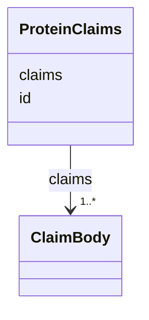

---
search:
  boost: 10.0
---

# Class: ProteinClaims 


_The claims about one protein._


<div data-search-exclude markdown="1">


URI: [peptalk:ProteinClaims](https://w3id.org/ai4curation/peptalk/ProteinClaims)





<!-- no inheritance hierarchy -->

## Slots

| Name | Cardinality and Range | Description | Inheritance |
| ---  | --- | --- | --- |
| [id](id.md) | 1 <br/> [String](String.md) | The protein, as the first word of its FASTA header | direct |
| [claims](claims.md) | 1..* <br/> [ClaimBody](ClaimBody.md) | The claims about this protein | direct |


## Usages

| used by | used in | type | used |
| ---  | --- | --- | --- |
| [ClaimsFile](ClaimsFile.md) | [proteins](proteins.md) | range | [ProteinClaims](ProteinClaims.md) |


## Identifier and Mapping Information


### Schema Source


* from schema: https://w3id.org/ai4curation/peptalk


## Mappings

| Mapping Type | Mapped Value |
| ---  | ---  |
| self | peptalk:ProteinClaims |
| native | peptalk:ProteinClaims |


## LinkML Source

<!-- TODO: investigate https://stackoverflow.com/questions/37606292/how-to-create-tabbed-code-blocks-in-mkdocs-or-sphinx -->

### Direct

<details>
```yaml
name: ProteinClaims
description: The claims about one protein.
from_schema: https://w3id.org/ai4curation/peptalk
attributes:
  id:
    name: id
    description: The protein, as the first word of its FASTA header.
    from_schema: https://w3id.org/ai4curation/peptalk
    rank: 1000
    domain_of:
    - ProteinClaims
    - Claim
    - Annotation
    required: true
  claims:
    name: claims
    description: The claims about this protein.
    from_schema: https://w3id.org/ai4curation/peptalk
    domain_of:
    - ClaimsFile
    - ProteinClaims
    range: ClaimBody
    required: true
    multivalued: true
    inlined_as_list: true

```
</details>

### Induced

<details>
```yaml
name: ProteinClaims
description: The claims about one protein.
from_schema: https://w3id.org/ai4curation/peptalk
attributes:
  id:
    name: id
    description: The protein, as the first word of its FASTA header.
    from_schema: https://w3id.org/ai4curation/peptalk
    rank: 1000
    owner: ProteinClaims
    domain_of:
    - ProteinClaims
    - Claim
    - Annotation
    range: string
    required: true
  claims:
    name: claims
    description: The claims about this protein.
    from_schema: https://w3id.org/ai4curation/peptalk
    owner: ProteinClaims
    domain_of:
    - ClaimsFile
    - ProteinClaims
    range: ClaimBody
    required: true
    multivalued: true
    inlined: true
    inlined_as_list: true

```
</details></div>