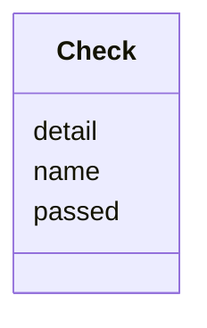

---
search:
  boost: 10.0
---

# Class: Check 


_One automatic check of an answer against the sequence, the claim or the shuffled control._


<div data-search-exclude markdown="1">


URI: [peptalk:class/Check](https://w3id.org/ai4curation/peptalk/class/Check)





<!-- no inheritance hierarchy -->

## Slots

| Name | Cardinality and Range | Description | Inheritance |
| ---  | --- | --- | --- |
| [name](../slots/name.md) | 1 <br/> [String](../types/String.md) |  | direct |
| [passed](../slots/passed.md) | 1 <br/> [Boolean](../types/Boolean.md) |  | direct |
| [detail](../slots/detail.md) | 1 <br/> [String](../types/String.md) | What failed, if anything | direct |


## Usages

| used by | used in | type | used |
| ---  | --- | --- | --- |
| [Annotation](../classes/Annotation.md) | [checks](../slots/checks.md) | range | [Check](../classes/Check.md) |


## Identifier and Mapping Information


### Schema Source


* from schema: https://w3id.org/ai4curation/peptalk


## Mappings

| Mapping Type | Mapped Value |
| ---  | ---  |
| self | peptalk:Check |
| native | peptalk:Check |


## LinkML Source

<!-- TODO: investigate https://stackoverflow.com/questions/37606292/how-to-create-tabbed-code-blocks-in-mkdocs-or-sphinx -->

### Direct

<details>
```yaml
name: Check
description: One automatic check of an answer against the sequence, the claim or the
  shuffled control.
from_schema: https://w3id.org/ai4curation/peptalk
attributes:
  name:
    name: name
    from_schema: https://w3id.org/ai4curation/peptalk
    rank: 1000
    domain_of:
    - Check
    required: true
  passed:
    name: passed
    from_schema: https://w3id.org/ai4curation/peptalk
    rank: 1000
    domain_of:
    - Check
    range: boolean
    required: true
  detail:
    name: detail
    description: What failed, if anything.
    from_schema: https://w3id.org/ai4curation/peptalk
    rank: 1000
    ifabsent: string("")
    domain_of:
    - Check
    required: true

```
</details>

### Induced

<details>
```yaml
name: Check
description: One automatic check of an answer against the sequence, the claim or the
  shuffled control.
from_schema: https://w3id.org/ai4curation/peptalk
attributes:
  name:
    name: name
    from_schema: https://w3id.org/ai4curation/peptalk
    rank: 1000
    owner: Check
    domain_of:
    - Check
    range: string
    required: true
  passed:
    name: passed
    from_schema: https://w3id.org/ai4curation/peptalk
    rank: 1000
    owner: Check
    domain_of:
    - Check
    range: boolean
    required: true
  detail:
    name: detail
    description: What failed, if anything.
    from_schema: https://w3id.org/ai4curation/peptalk
    rank: 1000
    ifabsent: string("")
    owner: Check
    domain_of:
    - Check
    range: string
    required: true

```
</details></div>