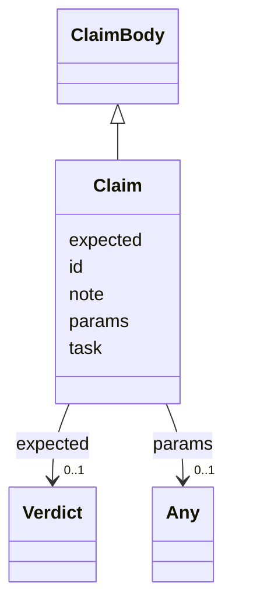

---
search:
  boost: 10.0
---

# Class: Claim 


_One claim about one protein._


<div data-search-exclude markdown="1">


URI: [peptalk:class/Claim](https://w3id.org/ai4curation/peptalk/class/Claim)





## Inheritance
* [ClaimBody](../classes/ClaimBody.md)
    * **Claim**


## Slots

| Name | Cardinality and Range | Description | Inheritance |
| ---  | --- | --- | --- |
| [id](../slots/id.md) | 1 <br/> [String](../types/String.md) | The protein, as the first word of its FASTA header | direct |
| [task](../slots/task.md) | 1 <br/> [String](../types/String.md) | The ask template that puts the claim to the model, such as ask-catalytic-resi... | [ClaimBody](../classes/ClaimBody.md) |
| [params](../slots/params.md) | 0..1 <br/> [Any](../classes/Any.md) | The template's parameters, all of them and no others, such as {position: 436,... | [ClaimBody](../classes/ClaimBody.md) |
| [expected](../slots/expected.md) | 0..1 <br/> [Verdict](../enums/Verdict.md) | The verdict you expect, for benchmarks | [ClaimBody](../classes/ClaimBody.md) |
| [note](../slots/note.md) | 0..1 <br/> [String](../types/String.md) | Any text | [ClaimBody](../classes/ClaimBody.md) |


## Usages

| used by | used in | type | used |
| ---  | --- | --- | --- |
| [ClaimsFile](../classes/ClaimsFile.md) | [claims](../slots/claims.md) | range | [Claim](../classes/Claim.md) |


## Identifier and Mapping Information


### Schema Source


* from schema: https://w3id.org/ai4curation/peptalk


## Mappings

| Mapping Type | Mapped Value |
| ---  | ---  |
| self | peptalk:Claim |
| native | peptalk:Claim |


## LinkML Source

<!-- TODO: investigate https://stackoverflow.com/questions/37606292/how-to-create-tabbed-code-blocks-in-mkdocs-or-sphinx -->

### Direct

<details>
```yaml
name: Claim
description: One claim about one protein.
from_schema: https://w3id.org/ai4curation/peptalk
is_a: ClaimBody
attributes:
  id:
    name: id
    description: The protein, as the first word of its FASTA header.
    from_schema: https://w3id.org/ai4curation/peptalk
    domain_of:
    - ProteinClaims
    - Claim
    - Annotation
    required: true

```
</details>

### Induced

<details>
```yaml
name: Claim
description: One claim about one protein.
from_schema: https://w3id.org/ai4curation/peptalk
is_a: ClaimBody
attributes:
  id:
    name: id
    description: The protein, as the first word of its FASTA header.
    from_schema: https://w3id.org/ai4curation/peptalk
    owner: Claim
    domain_of:
    - ProteinClaims
    - Claim
    - Annotation
    range: string
    required: true
  task:
    name: task
    description: The ask template that puts the claim to the model, such as ask-catalytic-residue
      (`peptalk tasks --ask` lists them).
    from_schema: https://w3id.org/ai4curation/peptalk
    rank: 1000
    owner: Claim
    domain_of:
    - ClaimBody
    - Annotation
    range: string
    required: true
  params:
    name: params
    description: 'The template''s parameters, all of them and no others, such as {position:
      436, residue: D}. Values may be written as numbers; they are read as text.'
    from_schema: https://w3id.org/ai4curation/peptalk
    rank: 1000
    owner: Claim
    domain_of:
    - ClaimBody
    - Annotation
    range: Any
  expected:
    name: expected
    description: The verdict you expect, for benchmarks. Never sent to the model and
      not part of the cache key.
    from_schema: https://w3id.org/ai4curation/peptalk
    rank: 1000
    owner: Claim
    domain_of:
    - ClaimBody
    - Annotation
    range: Verdict
  note:
    name: note
    description: Any text. Kept with the result, never sent to the model.
    from_schema: https://w3id.org/ai4curation/peptalk
    rank: 1000
    owner: Claim
    domain_of:
    - ClaimBody
    - Annotation
    range: string

```
</details></div>