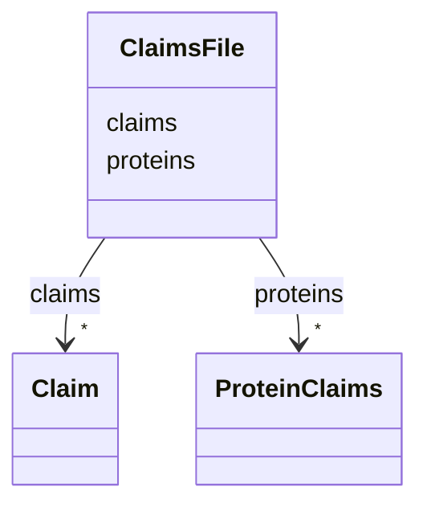

---
search:
  boost: 10.0
---

# Class: ClaimsFile 


_A claims file. Claims are grouped by protein (`proteins`) or listed flat (`claims`), or both. Write it in YAML; TSV and CSV with one row per claim are accepted for bulk input._


<div data-search-exclude markdown="1">


URI: [peptalk:class/ClaimsFile](https://w3id.org/ai4curation/peptalk/class/ClaimsFile)





<!-- no inheritance hierarchy -->

## Class Properties

| Property | Value |
| --- | --- |
| Tree Root | Yes |


## Slots

| Name | Cardinality and Range | Description | Inheritance |
| ---  | --- | --- | --- |
| [proteins](../slots/proteins.md) | * <br/> [ProteinClaims](../classes/ProteinClaims.md) | Claims grouped by protein | direct |
| [claims](../slots/claims.md) | * <br/> [Claim](../classes/Claim.md) | Claims listed one by one, each naming its protein | direct |


## Identifier and Mapping Information


### Schema Source


* from schema: https://w3id.org/ai4curation/peptalk


## Mappings

| Mapping Type | Mapped Value |
| ---  | ---  |
| self | peptalk:ClaimsFile |
| native | peptalk:ClaimsFile |


## LinkML Source

<!-- TODO: investigate https://stackoverflow.com/questions/37606292/how-to-create-tabbed-code-blocks-in-mkdocs-or-sphinx -->

### Direct

<details>
```yaml
name: ClaimsFile
description: A claims file. Claims are grouped by protein (`proteins`) or listed flat
  (`claims`), or both. Write it in YAML; TSV and CSV with one row per claim are accepted
  for bulk input.
from_schema: https://w3id.org/ai4curation/peptalk
attributes:
  proteins:
    name: proteins
    description: Claims grouped by protein.
    from_schema: https://w3id.org/ai4curation/peptalk
    rank: 1000
    domain_of:
    - ClaimsFile
    range: ProteinClaims
    multivalued: true
    inlined_as_list: true
  claims:
    name: claims
    description: Claims listed one by one, each naming its protein.
    from_schema: https://w3id.org/ai4curation/peptalk
    rank: 1000
    domain_of:
    - ClaimsFile
    - ProteinClaims
    range: Claim
    multivalued: true
    inlined_as_list: true
tree_root: true

```
</details>

### Induced

<details>
```yaml
name: ClaimsFile
description: A claims file. Claims are grouped by protein (`proteins`) or listed flat
  (`claims`), or both. Write it in YAML; TSV and CSV with one row per claim are accepted
  for bulk input.
from_schema: https://w3id.org/ai4curation/peptalk
attributes:
  proteins:
    name: proteins
    description: Claims grouped by protein.
    from_schema: https://w3id.org/ai4curation/peptalk
    rank: 1000
    owner: ClaimsFile
    domain_of:
    - ClaimsFile
    range: ProteinClaims
    multivalued: true
    inlined: true
    inlined_as_list: true
  claims:
    name: claims
    description: Claims listed one by one, each naming its protein.
    from_schema: https://w3id.org/ai4curation/peptalk
    rank: 1000
    owner: ClaimsFile
    domain_of:
    - ClaimsFile
    - ProteinClaims
    range: Claim
    multivalued: true
    inlined: true
    inlined_as_list: true
tree_root: true

```
</details></div>