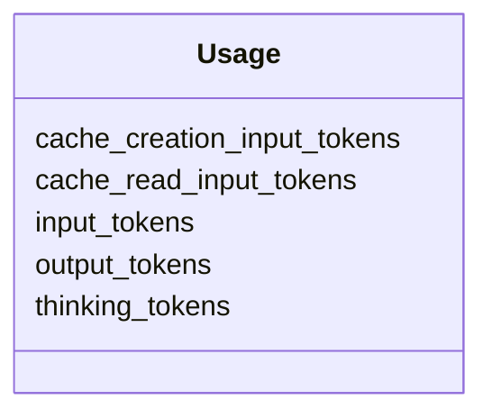

---
search:
  boost: 10.0
---

# Class: Usage 


_Token counts for one call. thinking_tokens is a part of output_tokens when reported._


<div data-search-exclude markdown="1">


URI: [peptalk:class/Usage](https://w3id.org/ai4curation/peptalk/class/Usage)





<!-- no inheritance hierarchy -->

## Slots

| Name | Cardinality and Range | Description | Inheritance |
| ---  | --- | --- | --- |
| [input_tokens](../slots/input_tokens.md) | 1 <br/> [Integer](../types/Integer.md) |  | direct |
| [output_tokens](../slots/output_tokens.md) | 1 <br/> [Integer](../types/Integer.md) |  | direct |
| [thinking_tokens](../slots/thinking_tokens.md) | 0..1 <br/> [Integer](../types/Integer.md) |  | direct |
| [cache_read_input_tokens](../slots/cache_read_input_tokens.md) | 1 <br/> [Integer](../types/Integer.md) |  | direct |
| [cache_creation_input_tokens](../slots/cache_creation_input_tokens.md) | 1 <br/> [Integer](../types/Integer.md) |  | direct |


## Usages

| used by | used in | type | used |
| ---  | --- | --- | --- |
| [Annotation](../classes/Annotation.md) | [usage](../slots/usage.md) | range | [Usage](../classes/Usage.md) |


## Identifier and Mapping Information


### Schema Source


* from schema: https://w3id.org/ai4curation/peptalk


## Mappings

| Mapping Type | Mapped Value |
| ---  | ---  |
| self | peptalk:Usage |
| native | peptalk:Usage |


## LinkML Source

<!-- TODO: investigate https://stackoverflow.com/questions/37606292/how-to-create-tabbed-code-blocks-in-mkdocs-or-sphinx -->

### Direct

<details>
```yaml
name: Usage
description: Token counts for one call. thinking_tokens is a part of output_tokens
  when reported.
from_schema: https://w3id.org/ai4curation/peptalk
attributes:
  input_tokens:
    name: input_tokens
    from_schema: https://w3id.org/ai4curation/peptalk
    rank: 1000
    ifabsent: int(0)
    domain_of:
    - Usage
    range: integer
    required: true
  output_tokens:
    name: output_tokens
    from_schema: https://w3id.org/ai4curation/peptalk
    rank: 1000
    ifabsent: int(0)
    domain_of:
    - Usage
    range: integer
    required: true
  thinking_tokens:
    name: thinking_tokens
    from_schema: https://w3id.org/ai4curation/peptalk
    rank: 1000
    domain_of:
    - Usage
    range: integer
  cache_read_input_tokens:
    name: cache_read_input_tokens
    from_schema: https://w3id.org/ai4curation/peptalk
    rank: 1000
    ifabsent: int(0)
    domain_of:
    - Usage
    range: integer
    required: true
  cache_creation_input_tokens:
    name: cache_creation_input_tokens
    from_schema: https://w3id.org/ai4curation/peptalk
    rank: 1000
    ifabsent: int(0)
    domain_of:
    - Usage
    range: integer
    required: true

```
</details>

### Induced

<details>
```yaml
name: Usage
description: Token counts for one call. thinking_tokens is a part of output_tokens
  when reported.
from_schema: https://w3id.org/ai4curation/peptalk
attributes:
  input_tokens:
    name: input_tokens
    from_schema: https://w3id.org/ai4curation/peptalk
    rank: 1000
    ifabsent: int(0)
    owner: Usage
    domain_of:
    - Usage
    range: integer
    required: true
  output_tokens:
    name: output_tokens
    from_schema: https://w3id.org/ai4curation/peptalk
    rank: 1000
    ifabsent: int(0)
    owner: Usage
    domain_of:
    - Usage
    range: integer
    required: true
  thinking_tokens:
    name: thinking_tokens
    from_schema: https://w3id.org/ai4curation/peptalk
    rank: 1000
    owner: Usage
    domain_of:
    - Usage
    range: integer
  cache_read_input_tokens:
    name: cache_read_input_tokens
    from_schema: https://w3id.org/ai4curation/peptalk
    rank: 1000
    ifabsent: int(0)
    owner: Usage
    domain_of:
    - Usage
    range: integer
    required: true
  cache_creation_input_tokens:
    name: cache_creation_input_tokens
    from_schema: https://w3id.org/ai4curation/peptalk
    rank: 1000
    ifabsent: int(0)
    owner: Usage
    domain_of:
    - Usage
    range: integer
    required: true

```
</details></div>